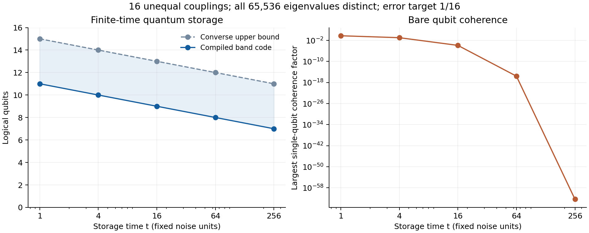

# Quantum Spectral Memory

**How much unknown quantum information can a finite register preserve during one interval of collective dephasing?**

With one Gaussian noise direction, the answer is controlled by how many noise eigenvalues fit inside one interval at the noise's finite-time resolution. With several commuting directions, a joint spectral cluster can miss a large amount of recoverable storage. The rank of the joint noise spectrum determines the sharp worst-case size of that gap. The [encoder walkthrough](#from-an-existence-theorem-to-an-encoder) gives the steps for the calibrated weighted-qubit memory.

## One noise direction

Let a known Hermitian operator $`A`$ generate Gaussian dephasing,

```math
\Phi_t(|i\rangle\langle j|)
=e^{-t(\lambda_i-\lambda_j)^2/2}|i\rangle\langle j|.
```

Only the physical register carries quantum information through the storage interval. Encoding and recovery occur at its boundaries; arbitrary retained classical records are allowed. Error is measured in half diamond distance, so the guarantee protects an unknown state entangled with an inaccessible reference.

Count eigenvalues with multiplicity and define

```math
M_t=\max_a\#\{i:\lambda_i\in[a,a+t^{-1/2}]\}.
```

For any fixed $`0\lt \epsilon\lt 1/4`$, the optimal stored dimension satisfies

```math
\log_2D_\epsilon(t;A)=\log_2M_t+O_\epsilon(1).
```

The explicit bounds, their constants, and a converse covering arbitrary mixed encoders are proved in [the spectral law](science/spectral_law.md). The result applies to finite, irregular, degenerate and nondegenerate spectra.

## Several commuting noise directions

Let $`r`$ be the affine dimension of the covariance-weighted joint spectrum and $`M`$ the largest number of spectral points in a unit ball, counted with multiplicity. At fixed $`0\lt\epsilon\lt1/4`$, the [joint spectral theorem](science/multiple_noise_directions.md) gives the worst-case discrepancy

```math
\sup_{\text{rank }r}\big(\log_2D_\epsilon-\log_2M\big)
=\frac r2\log_2r+O_\epsilon(r).
```

The supremum ranges over finite joint spectra. A family with $`M=1`$ attains the leading term. Its encoder uses superpositions across separated spectral points and recovery at the end of the same passive interval. In a separate explicit example, 151 independently dephasing qubits support one logical qubit by phase repetition at half-diamond error below $`1/16`$, even though every unit ball contains at most one spectral point.

## From an existence theorem to an encoder

For

```math
A=\sum_{j=1}^n g_jN_j,\qquad N_j=|1\rangle\langle1|_j,
```

use the [calibrated compiler](science/encoder.md) to store an unknown logical register.

1. **Choose the band.** Supply a rational hold time and error target, along with certified signed coupling estimates. Use the [dyadic-grid rule](science/encoder.md#1-exact-dyadic-grid-selection) to check that each certificate meets the required precision. Round the estimates and use integer dynamic programming to count strings by weighted sum. Find the most populated [closed band](science/encoder.md#2-signed-weights-and-the-optimal-closed-band). Take the largest power of two that fits its population, then use that many accepted strings from the start of the specified order.
2. **Encode and hold.** Initialize the physical and work registers to zero. Reversibly unrank the input into the physical register, XOR the codeword's rank into the input register to clear it, and apply the known X flips for negative weights. The [X, CNOT and Toffoli circuits](science/encoder.md#4-rank-and-unrank-as-total-boolean-circuits) uncompute their work. Release or reset the cleared registers. Only the physical register carries the state while the specified dephasing acts.
3. **Decode.** Supply fresh zero logical and work registers and reverse the encoding gates. Return the recovered quantum register. The procedure uses no measurement, feedforward or retry. The [half-diamond error budget](science/encoder.md#6-composable-implementation-error-budget) protects reference-entangled inputs. Ideal storage uses at most nine sixteenths of the target error, leaving seven sixteenths for both endpoints.

The [finite gate checks](verification/README.md) exercise the emitted primitives and workspace cleanup. Classical table construction, literal lookup scans, and temporary wires are counted in the compiler.

At fixed error, its logical dimension is within a spectrum-independent constant number of qubits of the unrestricted optimum. The compiler is polynomial for bounded couplings, polynomial storage time, and fixed or inverse-polynomial error tolerance. The explicit qubit gap grows with the demanded accuracy; polynomial time in the binary length of the storage time is not claimed.

The [fixed-weight compiler](science/fixed_weight_encoder.md) uses signed integer counts within a prescribed Hamming-weight sector, where a common coupling offset contributes only a scalar phase. [Quantum Memory Calibration](https://github.com/GoGoKo699/Quantum-Memory-Calibration/blob/main/science/compiled_calibration.md) uses these clean blocks and endpoint phase correction to attain the sharp leading calibration budget with polynomial endpoint costs at polynomial hold times.

## A finite example



All 65,536 eigenvalues in this example are distinct. At exposure $`t=256`$, the compiler stores seven logical qubits with a certified storage half-diamond error at most $`9/256`$, below the target $`1/16`$. At that exposure, even the largest bare single-qubit off-diagonal factor is about $`4.48\times10^{-63}`$.

The upper curve is a conservative converse bound, not the exact optimum. The right panel is a single-qubit coherence diagnostic, not a comparison against every uncoded strategy or a hardware performance claim. The [example account](science/examples.md) gives the exact rational inputs, interpretation, and computational costs.

## Read the result

| Question | Account |
|---|---|
| What is the model, and what resources are permitted? | [Operational model](science/model.md) |
| Why does spectral occupancy characterize storage with one noise direction? | [Scalar law](science/spectral_law.md) |
| How far can joint spectral occupancy fall short? | [Several noise directions](science/multiple_noise_directions.md) |
| How is the code compiled with finite precision and clean workspace? | [Encoder construction](science/encoder.md) |
| How can a conserved weight remove a common coupling offset? | [Fixed-weight compiler](science/fixed_weight_encoder.md) |
| What do concrete spectra and circuits demonstrate? | [Examples](science/examples.md) |
| How do finite time, exact noiseless sectors and communication capacity differ? | [Consequences and interpretation](science/interpretation.md) |
| Which ingredients are inherited, and what is the specific contribution? | [Related work](references/related_work.md) and [bibliography](references/references.bib) |
| How can the numerical and circuit checks be reproduced? | [Verification guide](verification/README.md) |

The [science overview](science/README.md) connects the proof dependencies. The independent-use communication-capacity corollary is a separate consequence; it does not add operations inside a storage interval.

## Learn the project

The educational anchor is John Watrous, *The Theory of Quantum Information* (2018). Start with the [bridge from Watrous to spectral memory](learning/anchor.md), which identifies the relevant sections, translates conventions and works through a small protected-coherence example. The [30-milestone map](learning/milestones.md) then connects 11 background milestones to 19 milestones developing the spectral law, calibrated compiler, evidence and physical interpretation.

The map follows this project's scientific dependencies. Each milestone states an understanding target and points to the canonical proof or example; it does not require reading the entire textbook first. Readers already familiar with quantum channels can go directly to the [spectral law](science/spectral_law.md) and [encoder](science/encoder.md).

## Reproduce the checks

With Python 3.12, run from the repository root:

    python -m pip install -r verification/requirements.txt
    python verification/run_all.py
    python verification/generate_examples.py
    python verification/verify_noise_rank.py
    python verification/verify_fixed_weight.py

The checks include exact rational band enumeration, Gaussian-matrix inequalities, and actual reversible-gate propagation of basis and reference-entangled inputs. The 16-qubit illustration uses the classical dynamic program; the full primitive circuits are verified on smaller instances. Finite tests support the implementations and examples. The mathematical proofs establish the general storage and complexity claims.

## Scope

The storage results use known, fixed commuting Gaussian noise generators and ideal boundary operations. The calibrated reversible compiler applies to the one-direction weighted-qubit model with supplied certificates. The general rank-dependent attaining family allows arbitrary commuting generators and unrestricted endpoint recovery. The local repetition example uses independent Gaussian dephasing on physical qubits. Physical calibration cost, coupling drift, and fault-tolerant hardware overhead remain outside these results.

The [related-work account](references/related_work.md) credits the inherited comparison, reversible encoding and error-correction methods and identifies the finite-time results established here.

## Purpose

This repository serves as a record of the work and a guide for the author’s self-directed learning. For discussion or potential collaboration, please contact Ruge Lin at [gogoko699@gmail.com](mailto:gogoko699@gmail.com).
