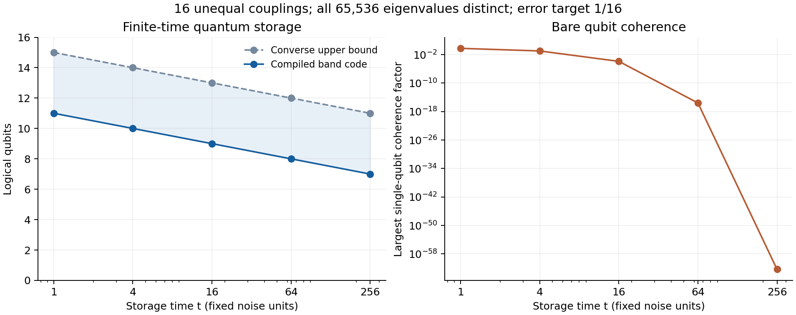

# Quantum Spectral Memory

**How much unknown quantum information can a finite register preserve during one interval of collective dephasing?**

The answer is controlled by how many noise eigenvalues fit inside one interval at the noise's finite-time resolution. For an arbitrary finite spectrum, this repository proves matching storage bounds up to constants at fixed error. For a register with explicitly known, unequal local couplings, it gives a finite-precision compiler whose code loses only a constant number of logical qubits relative to every allowed endpoint encoding and recovery.

## Main result

Let a known Hermitian operator $`A`$ generate Gaussian dephasing,

```math
\Phi_t(|i\rangle\langle j|)
=e^{-t(\lambda_i-\lambda_j)^2/2}|i\rangle\langle j|.
```

Only the physical register carries quantum information through the storage interval. Encoding and recovery occur at its boundaries; arbitrary retained classical records are allowed. Error is measured in half diamond distance, so the guarantee protects an unknown state entangled with an inaccessible reference.

Count eigenvalues with multiplicity and define

```math
M_t=\max_a\#\{i:\lambda_i\in[a,a+t^{-1/2}]\}.
```

For any fixed $`0\lt \epsilon\lt 1/4`$, the optimal stored dimension satisfies

```math
\log_2D_\epsilon(t;A)=\log_2M_t+O_\epsilon(1).
```

The explicit bounds, their constants, and a converse covering arbitrary mixed encoders are proved in [the spectral law](science/spectral_law.md). The result applies to finite, irregular, degenerate and nondegenerate spectra.

## From an existence theorem to an encoder

For

```math
A=\sum_{j=1}^n g_jN_j,\qquad N_j=|1\rangle\langle1|_j,
```

the [calibrated compiler](science/encoder.md) rounds certified coupling estimates to a dyadic grid, finds a populous weighted-sum band by integer dynamic programming, and implements rank and unrank coherently with primitive reversible gates. Every temporary register is cleared before storage.

At fixed error, its logical dimension is within a spectrum-independent constant number of qubits of the unrestricted optimum. The compiler is polynomial for bounded couplings, polynomial storage time, and fixed or inverse-polynomial error tolerance. The explicit qubit gap grows with the demanded accuracy; polynomial time in the binary length of the storage time is not claimed.

## A finite example



All 65,536 eigenvalues in this example are distinct. At exposure $`t=256`$, the compiler stores seven logical qubits with a certified storage half-diamond error at most $`9/256`$, below the target $`1/16`$. At that exposure, even the largest bare single-qubit off-diagonal factor is about $`4.48\times10^{-63}`$.

The upper curve is a conservative converse bound, not the exact optimum. The right panel is a single-qubit coherence diagnostic, not a comparison against every uncoded strategy or a hardware performance claim. The [example account](science/examples.md) gives the exact rational inputs, interpretation, and computational costs.

## Read the result

| Question | Account |
|---|---|
| What is the model, and what resources are permitted? | [Operational model](science/model.md) |
| Why does spectral occupancy characterize storage? | [Theorem and proofs](science/spectral_law.md) |
| How is the code compiled with finite precision and clean workspace? | [Encoder construction](science/encoder.md) |
| What do concrete spectra and circuits demonstrate? | [Examples](science/examples.md) |
| How do finite time, exact noiseless sectors and communication capacity differ? | [Consequences and interpretation](science/interpretation.md) |
| Which ingredients are inherited, and what is the specific contribution? | [Related work](references/related_work.md) and [bibliography](references/references.bib) |
| How can the numerical and circuit checks be reproduced? | [Verification guide](verification/README.md) |

The [science overview](science/README.md) connects the proof dependencies. The independent-use communication-capacity corollary is a separate consequence; it does not add operations inside a storage interval.

## Learn the project

The educational anchor is John Watrous, *The Theory of Quantum Information* (2018). Start with the [bridge from Watrous to spectral memory](learning/anchor.md), which identifies the relevant sections, translates conventions and works through a small protected-coherence example. The [30-milestone map](learning/milestones.md) then connects 11 background milestones to 19 milestones developing the spectral law, calibrated compiler, evidence and physical interpretation.

The map follows this project's scientific dependencies. Each milestone states an understanding target and points to the canonical proof or example; it does not require reading the entire textbook first. Readers already familiar with quantum channels can go directly to the [spectral law](science/spectral_law.md) and [encoder](science/encoder.md).

## Reproduce the checks

With Python 3.12, run from the repository root:

    python -m pip install -r verification/requirements.txt
    python verification/run_all.py
    python verification/generate_examples.py

The checks include exact rational band enumeration, Gaussian-matrix inequalities, and actual reversible-gate propagation of basis and reference-entangled inputs. The 16-qubit illustration uses the classical dynamic program; the full primitive circuits are verified on smaller instances. Finite tests support the implementations and examples. The mathematical proofs establish the general storage and complexity claims.

## Scope

This is a result for one known common Gaussian noise direction. The true couplings are fixed during the storage interval and lie within the supplied calibration certificates. The core storage theorem treats boundary operations as ideal; a separate composable error budget explains what additional boundary accuracy suffices. Physical calibration cost, local noise, unmodeled time-dependent coupling drift, geometric circuit locality and fault-tolerant hardware overhead are not determined by this model.

Approximate protected subspaces, high rates under exact collective symmetry, channel comparison methods, and reversible combinatorial encoding are established ideas. The specific contribution is their finite-spectrum occupancy characterization together with a calibrated compiler certified against unrestricted endpoint codes. The [related-work account](references/related_work.md) makes the comparisons explicit, including the earlier fixed-Hamming-weight amplitude encoder coauthored by Ruge Lin.

## Purpose

This repository serves as a record of the work and a guide for the author’s self-directed learning. For discussion or potential collaboration, please contact Ruge Lin at [gogoko699@gmail.com](mailto:gogoko699@gmail.com).
