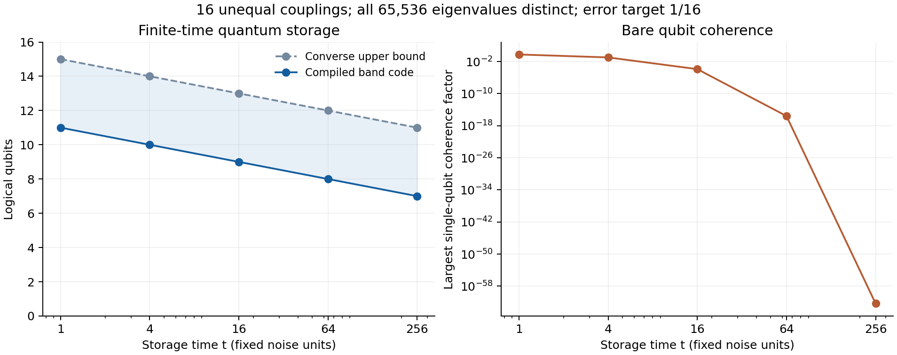

# Examples: exact sectors, unequal couplings and compiled circuits

## Homogeneous coupling recovers the exact noiseless sectors

If every coefficient equals a common nonzero $`g`$, then

```math
A=g\sum_{j=1}^nN_j,\qquad
E_x=g\,|x|.
```

Every fixed-Hamming-weight subspace is an exact eigenspace, with dimension $`\binom nk`$ at weight $`k`$. The central sector has dimension $`\binom n{\lfloor n/2\rfloor}`$. By [Proposition 2](spectral_law.md#proposition-2-exact-storage-at-every-positive-time), this is the exact memory dimension at every positive exposure.

Stirling's estimate gives $`\log_2\binom n{\lfloor n/2\rfloor}=n-\tfrac12\log_2 n+O(1)`$. High rates under homogeneous collective dephasing are therefore already available from exact noiseless sectors; see D'Arrigo, Benenti and Falci, [Section 3.3](https://arxiv.org/html/quant-ph/0703014v3). If $`g=0`$, the entire register is noiseless instead.

For unequal coefficients, exact degeneracies can disappear. A narrow interval can nevertheless contain exponentially many distinct eigenvalues at a polynomial exposure. That finite-time population is what the occupancy law measures.

## An exactly specified nondegenerate 16-qubit register

The executable example uses $`n=16`$, error target $`\epsilon=1/16`$, and sixteen rational couplings in $`[1,2)`$. They are generated from the fixed seed 20261103 with denominator $`2^{40}`$ and are stored explicitly in [examples.json](../verification/results/examples.json). Exact rational enumeration verifies that all $`2^{16}=65{,}536`$ subset-sum eigenvalues are distinct.

For each requested exposure, the compiler selects its dyadic grid and receives estimates rounded to that grid, together with the certified error $`\delta/2`$ for each coefficient. The script verifies those certificates against the specified true rational couplings. It computes the rounded band by dynamic programming and the true occupancy by exhaustive enumeration. Enumeration is used to check this example, not by the general compiler.

| Exposure $`t`$ | Grid $`\delta`$ | True occupancy $`M_t`$ | Selected band population | Compiled logical qubits | Converse upper bound on logical qubits |
|---:|---:|---:|---:|---:|---:|
| 1 | $`1/256`$ | 8,702 | 2,315 | 11 | 15 |
| 4 | $`1/512`$ | 4,492 | 1,162 | 10 | 14 |
| 16 | $`1/1024`$ | 2,278 | 592 | 9 | 13 |
| 64 | $`1/2048`$ | 1,147 | 304 | 8 | 12 |
| 256 | $`1/4096`$ | 586 | 157 | 7 | 11 |

Each code has the same conservative storage error certificate,

```math
\frac12\|\Lambda_t-\mathrm{id}\|_\diamond
\le\frac{9\epsilon}{16}=\frac9{256}.
```

The allowed total error is $`1/16`$. A separately supplied composable boundary-operation budget of at most $`7/256`$ suffices to meet that target. The ideal-circuit example does not assume that a particular device meets this additional budget.

The upper-bound column is

```math
\min\left\{16,\left\lfloor
\log_2\frac{(2+\sqrt{2\pi})M_t}{1-\epsilon}
\right\rfloor\right\}.
```

It is a certified ceiling from a conservative theorem, not a computed optimum. The four-qubit separation between the two columns does not show that a better code actually exists.



**Figure.** Left: the compiled code and the converse ceiling at the five specified exposures. Lines guide the eye between discrete data. Right: the largest single-qubit off-diagonal attenuation factor,

```math
\max_j e^{-tg_j^2/2}.
```

At $`t=256`$ this factor is approximately $`4.48\times10^{-63}`$, while the band code retains seven logical qubits at the certified error. Single-qubit attenuation is a physical noise diagnostic. It is not the optimal uncoded-storage fidelity, and it does not account for the cost or noise of implementing the encoder.

These are separate codes compiled for five known storage times. The calculation does not reconfigure a memory during storage or claim one fixed code achieves all five populations.

## What the large example costs

The number of integer entries retained in the suffix-prefix tables grows from 53,421 at $`t=1`$ to 854,526 at $`t=256`$. Table entries are arbitrary-precision integers; their word size and all compiled lookup gates are counted in the [resource analysis](encoder.md#3-exact-classical-preprocessing).

The example runs the classical compiler for all sixteen physical qubits. It does not emit or simulate the full primitive circuit at that size. The clean coherent implementation follows from the explicit rank/unrank construction, whose gate-level behavior is checked on smaller cases below. No exponential-size quantum state vector is needed for the classical band search.

## Small primitive circuits

The [reversible checker](../verification/verify_reversible_encoder.py) compiles actual $`X`$, CNOT and Toffoli instructions for signed and zero weights. The five cases use three through six physical qubits and include an all-zero rounded vector whose true coefficients are nonzero within their allowed uncertainties.

| Physical qubits | Logical qubits | Encoder gates | Temporary work qubits |
|---:|---:|---:|---:|
| 3 | 2 | 652 | 132 |
| 4 | 2 | 2,007 | 361 |
| 5 | 3 | 4,238 | 756 |
| 6 | 4 | 9,684 | 1,688 |
| 4, zero rounded weights | 4 | 848 | 191 |

The intentionally transparent implementation retains fresh Boolean work wires before uncomputing them. This proves implementability with polynomial resources, while leaving substantial space and gate optimization possible.

All logical basis encodings are checked, all temporary registers return to zero, and the inverse circuit is checked both on code inputs and arbitrary full-register basis states. Maximally entangled and generic complex reference-entangled inputs pass through physical dephasing and the inverse circuit. Their resulting logical density matrices agree with the predicted Gaussian Schur channel. These are checks of actual primitive gates, rather than substitutions of a precomputed rank/unrank permutation.

The [verification guide](../verification/README.md) states the numerical tolerances and evidence limits. An experimental memory advantage would require a specified device, calibration procedure, gate implementation and full noise model.

## Scaling interpretation

For bounded couplings, the uniform computational-basis variance is $`V=\tfrac14\sum_jg_j^2`$. The [variance bound](interpretation.md#a-rate-bound-from-spectral-variance) gives

```math
m\ge n-\frac12\log_2\left(1+t\sum_jg_j^2\right)-O_\epsilon(1).
```

At any prescribed polynomial exposure and fixed error, the construction therefore stores $`n-O(\log n)`$ logical qubits. For each fixed nondegenerate register, sufficiently long exposure eventually removes every nontrivial approximate memory at error below one half. Those statements concern different orders of limits and are compatible.

[Scientific overview](README.md) · [Construction](encoder.md) · [Interpretation](interpretation.md)
